# Aura — Agentic SRE Co-pilot

Aura watches a running app, detects anomalies, correlates them with recent deploys, recalls similar
past incidents from memory, forms a root-cause hypothesis, and proposes a fix. **Nothing destructive
runs without human approval.** Every resolved (or rejected) incident is written back into memory,
so diagnosis gets faster and more confident over time.

<p align="center"></p>


## Repository layout

| Path | What it is |
|---|---|
| `agent/` | Python LangGraph pipeline + FastAPI server (port 8700), Qdrant/Neo4j memory, seed runbooks |
| `aura-cli/` | Terminal UI (Ink/React): live incident feed, state panel, chat, `/approve` |
| `problem/` | Failure injector + virtual-user traffic simulator for the demo site |
| `aura-technical-reference.md` | Full design reference (state object, agents, metrics) |

The demo target site ("VOID" shop) lives in `problem/website-template/`. `npm run setup-website` copies it to `test-website/` (gitignored) and makes that a local-only git repo, so deploy scenarios can commit "bad pushes" for Aura to find.

## Quick start

Prerequisites: Docker, Python 3.12 + [`uv`](https://docs.astral.sh/uv/), Node.js 20+, an NVIDIA GPU (CUDA 12.8 wheels) for local embeddings.

```bash
# 1. Memory stores (Qdrant :6333, Neo4j :7474)
cd agent
cp .env.example .env            # fill in API keys / passwords
docker compose up -d

# 2. Agent deps + seed memory (once)
uv sync
uv run python -m aura.memory.seed

# 3. Create and start the demo site (test-website/ is generated, local-only git repo)
(cd ../problem && npm install && npm run setup-website)
(cd ../test-website && npm install && docker compose up -d db && npm start)

# 4. Launch the UI (starts the agent server if it isn't running)
cd ../aura-cli && npm install && npm start
```

Run the server on its own: `cd agent && uv run python -m aura.main`

## Demo: break something and watch Aura fix it

```bash
cd problem && npm install
npm run traffic -- --users 20             # realistic shoppers (own terminal)
node inject.js list                       # available failure scenarios
node inject.js bad-deploy-checkout-500    # break the site
node inject.js recover all                # undo manually if needed
```

Scenarios include bad deploys, memory leaks, CPU hot paths, DB pool leaks, slow queries,
connection exhaustion, table locks, DB outages and traffic spikes. See `problem/README.md`.

Actions Aura can propose: `rollback`, `restart_service`, `terminate_db_sessions`, `start_db`,
`scale` / `investigate_further` (advisory).

## Roadmap

- **Web dashboard** — live incident feed, RCA trail with evidence, one-click approve/reject,
  service dependency graph visualisation, incident history and memory search.
- **Mobile app** — push notifications for new incidents and approve/reject from the phone,
  so on-call engineers can act without opening a laptop.
- **Integrations** — Slack / Teams / email notifications and approvals.
- **Kubernetes support** — operator plus `aura connect` auto-detection of services.
- **Multi-tenant** — auth, teams, audit log, production hardening.
- **Smarter learning** — measured memory effect (faster, higher-confidence RCA on repeat incidents).
